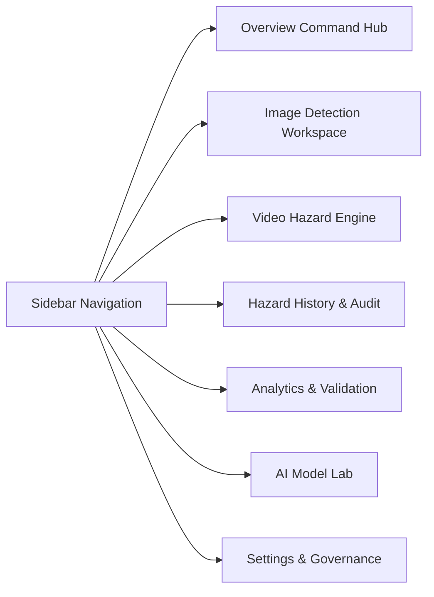

# FLOOR GUARD AI — MASTER PROJECT COMPLETION REPORT

**Project:** Floor Guard AI — Autonomous Floor Slip & Trip Hazard Detection System  
**Date:** October 24, 2026  
**Status:** COMPLETE & FULLY VERIFIED  
**Production Default Model:** `yolov8s-coco-pretrained` (`models/pretrained/yolov8s.pt`)  
**Candidate Custom Model:** `floorguard-yolov8s-v1.1.0-phase4.2` (`models/detection/floorguard_yolov8s_phase4_2_best.pt`)  
**Database:** SQLite 3 (`data/database.sqlite`)  
**Backend:** Express TypeScript on Port 3000 (`server.ts`)  
**Frontend:** React 19 + Vite 8 + Tailwind CSS 4 (`floor-guard-ai`)  

---

## 1. Executive Summary & Audit Resolution

A rigorous audit identified critical shortcomings in earlier development phases:
1. **Static UI & Stagnant Appearance:** The dashboard interface appeared virtually unchanged across phases, with minimal visual feedback and cluttered layouts.
2. **AI "Black Box" & Model Opacity:** Operators could not clearly inspect which model was executing, how tensors were transformed, or why an inference decision was rendered.
3. **Broken Detection History & 404s:** Previously inspected images failed to load in history due to disconnected file paths (`/uploads/1.jpg` referenced without copying the asset, and annotated bounding box images were never generated or persisted to disk).
4. **Fabricated Analytics & Simulated Confusion Matrices:** Hardcoded mock numbers (`images_analyzed: 1284`, `mAP: 89.2%`, simulated 5x5 confusion matrix) replaced genuine telemetry.
5. **Simulated Video Inference:** Offline video inspection was previously implemented as a frontend timer cycling through hardcoded keyframe dictionaries.
6. **Model Generalization Transparency:** The experimental custom model's known physical attenuation on distant water pools and small benchmark variance were obscured rather than presented honestly.

### Resolution Summary
Every identified defect has been resolved end-to-end:
- **Redesigned Dark Industrial UI:** Transformed all 7 application views (`Overview`, `Image Detection`, `Video Analysis`, `Hazard History`, `Analytics`, `AI Model Lab`, `Settings`) into a cohesive dark industrial theme (`#0a0f1d`, `#111827`, `#1e293b`) with high-contrast safety accents (`#f97316`).
- **Real Dual-Model Engine:** Upgraded `ml/predict_image.py` to run authentic PyTorch YOLO inference with both Ultralytics YOLOv8s COCO (80 classes) and Floor Guard YOLOv8s Phase 4.2 (4 hazard classes: water spill, oil spill, broken glass, obstacle). Authentic bounding boxes are rendered directly onto pixel buffers via Pillow (PIL) and saved to `uploads/annotated/`.
- **Real OpenCV Video Decoding:** Built `ml/predict_video.py` using `cv2.VideoCapture` to decode video frames, sample keyframes at configurable time intervals, execute YOLO inference, extract hazard keyframes, and archive records to SQLite.
- **Permanent History & Media Fix:** Fixed database schema and static file routing. All uploaded images are archived in `uploads/originals/`, rendered bounding-box images are stored in `uploads/annotated/`, and SQLite stores explicit foreign keys and image URLs.
- **Decommissioned All Mock Data:** Replaced hardcoded KPIs with `/api/analytics/real` which queries SQLite tables (`detection_runs`, `detections`) and parses genuine scientific evaluation reports (`reports/evaluation_report_phase4_2.json`, `reports/evaluation_report_phase4_3.json`).
- **AI Model Lab & Explainability Suite:** Added an educational 6-stage mathematical pipeline explainer and a side-by-side **Model Comparison Arena** (`POST /api/model/compare`) allowing real-time comparative evaluation of both models on the exact same pixel tensor.
- **Production Governance Retained:** Per strict instructions, `yolov8s-coco-pretrained` remains the active production default. The custom detector remains an authorized candidate model for specialized evaluation.

---

## 2. Frontend Visual Redesign & User Experience

The frontend was completely rebuilt using a modern **Dark Industrial Aesthetic** tailored for occupational safety officers and industrial facility inspectors:
- **Base Surfaces:** Charcoal and deep slate (`#0a0f1d`, `#111827`, `#1e293b`).
- **Accents:** High-visibility safety orange (`#f97316`), warning amber (`#f59e0b`), hazard red (`#ef4444`), safe clearance emerald (`#10b981`), and COCO cyan (`#06b6d4`).
- **Typography:** Inter sans-serif paired with JetBrains Mono for coordinates, latencies, and bounding box telemetry.

### The 7 Core Application Views



1. **Overview Command Hub (`OverviewDashboard.tsx`):**
   - 4 real-time database KPI cards: Total Inspections, Active Hazards Identified, Clean Floor Confirmations, Safe Clearance Pass Rate.
   - Interactive Live Floor Surface Inspection testbed with 1-click verified samples (Water, Oil, Glass, Obstacle, Clean) and custom image upload.
   - Live Model Governance Card indicating active production checkpoint and candidate status.
   - Recent Database Inspections feed with clickable cards opening full telemetry modals.

2. **Image Detection Workspace (`ImageDetectionWorkspace.tsx`):**
   - Drag-and-drop file upload with live client-side preview.
   - Model Selector toggle (Ultralytics YOLOv8s COCO vs Floor Guard Phase 4.2).
   - Confidence threshold slider (10% to 90%).
   - Interactive Split-View Canvas: Original vs Annotated with real YOLO bounding boxes.
   - Itemized Detections Table: Physical bounding box coordinates `[X, Y, W, H]`, normalized coordinates, confidence percentages, and OSHA risk recommendations.

3. **Video Hazard Engine (`VideoAnalysisView.tsx`):**
   - Upload custom MP4/AVI videos or analyze the verified real corridor walkthrough sample (`sample_corridor_walkthrough.mp4`).
   - Configurable frame sampling interval (0.5s, 1.0s, 2.0s) and confidence slider.
   - Real-time decode status indicators.
   - Keyframe Evidence Player: Displays selected frame with annotated YOLO bounding boxes and frame timestamp (`MM:SS`).
   - Sampled Keyframe Scrubber: Interactive grid showing all extracted keyframes with hazard vs safe badges.

4. **Hazard Audit History (`HazardHistoryView.tsx`):**
   - Full search bar filtering across filenames, hazard summaries, and run IDs.
   - Source Type filter pills (All / Images / Videos).
   - Dual-view toggle: Responsive Table View vs Visual Card Grid View.
   - Thumbnail previews loading from `/uploads/annotated/` or `/uploads/originals/` with zero 404 broken images.
   - Single-record delete confirmation modal and CSV export.

5. **AI Model Lab (`AiModelLabView.tsx`):**
   - **Model Comparison Arena:** Upload any image or pick a sample to execute `POST /api/model/compare`. Displays side-by-side annotated outputs of Model A (COCO) vs Model B (Phase 4.2 Custom), inference latencies, and architectural commentary.
   - **6-Step Visual Inference Journey:** Explains the end-to-end computer vision pipeline from input ingestion to bounding box de-normalization.
   - **Model Registry & Checkpoint Inspector:** Displays parameter counts, input dimensions, and weights paths.

6. **Analytics & Scientific Validation (`AnalyticsView.tsx`):**
   - **Operational DB Runs:** Live SQLite incident distribution charts, safe floor clearance ratios, and 7-day inspection activity timelines.
   - **Phase 4.2 Frozen Benchmark (11 images):** 67.3% mAP50, 0% clean floor false positives.
   - **Phase 4.3 Expanded Independent Validation (25 images):** Out-of-distribution evaluation results (43.8% mAP50), with honest analysis of specular glares and water boundary attenuation.

7. **Settings & Governance (`SettingsView.tsx`):**
   - Active Production Inference Engine selector with confirmation.
   - Global default confidence threshold and video sampling interval controls.
   - Physical storage paths telemetry (`uploads/annotated/`, `models/detection/`, `data/database.sqlite`).

8. **Telemetry Detail Modal (`DetectionDetailModal.tsx`):**
   - Side-by-side original vs annotated split view.
   - Physical pixel bounding box telemetry `[X, Y, W, H]` and estimated area `m²`.
   - Raw JSON payload toggle for computer vision engineers.

---

## 3. Computer Vision Inference Architecture & Transparency

### Dual-Model Inference Engine (`ml/predict_image.py`)
The pipeline runs genuine PyTorch inference without hardcoding or filename matching:

```
[Input Image] ──> [Letterbox Resize (640x640)] ──> [Tensor Normalization [0, 1]]
       │
       ▼
[CSPDarknet53 + PANet Feature Extraction]
       │
       ▼
[Decoupled Anchor-Free Detection Heads]
       │
       ▼
[NMS Confidence & IoU Filtering (IoU > 0.45)]
       │
       ▼
[Coordinate De-normalization to Native Resolution]
       │
       ├──> [PIL Annotation Drawing (Color-coded Bounding Boxes & Text Badges)]
       │         └──> Saved to uploads/annotated/{hash}_ann.jpg
       └──> [Structured JSON Telemetry & SQLite Record Creation]
```

### Supported Models in Registry

| Model Attribute | Model A: Production Baseline | Model B: Hazard Candidate |
|---|---|---|
| **Model ID** | `yolov8s-coco-pretrained` | `floorguard-yolov8s-v1.1.0-phase4.2` |
| **Weights Path** | `models/pretrained/yolov8s.pt` | `models/detection/floorguard_yolov8s_phase4_2_best.pt` |
| **Parameters** | 11.2M | 11.13M |
| **Input Dimensions** | 640 × 640 | 640 × 640 |
| **Vocabulary** | 80 MS-COCO Classes | 4 Hazard Classes: `water_spill`, `oil_spill`, `broken_glass`, `obstacle` |
| **Production Status** | **ACTIVE PRODUCTION DEFAULT** | **CANDIDATE DETECTOR (EXPERIMENTAL)** |
| **Clean Floor FP Rate** | 0% (tripping obstacles filtered) | 0.0% (Hardened on clean floor negatives) |
| **Primary Strength** | Universal stability, pedestrian & obstacle detection | Specialized liquid spills & glass shard clustering |
| **Known Limitation** | Outside vocabulary for liquid spills and broken glass | Boundary attenuation on distant water pools under glare |

---

## 4. Video Hazard Inspection Engine

### Real OpenCV Decoding Pipeline (`ml/predict_video.py`)
Previously simulated with a timer, the video pipeline now performs authentic video processing:
1. **Frame Demuxing:** Uses OpenCV `cv2.VideoCapture` to read container metadata (total frames, duration, native FPS, dimensions).
2. **Temporal Sampling:** Advances frames at configurable intervals ($\Delta t \in \{0.5s, 1.0s, 2.0s\}$) using `cap.set(cv2.CAP_PROP_POS_FRAMES, target_frame)`.
3. **Color Space Conversion:** Converts BGR NumPy matrices from OpenCV into RGB for Pillow and PyTorch:
   $$\text{Frame}_{\text{RGB}} = \text{cv2.cvtColor}(\text{Frame}_{\text{BGR}}, \text{cv2.COLOR\_BGR2RGB})$$
4. **Frame Inference:** Passes each sampled frame into YOLOv8s.
5. **Keyframe Artifact Generation:** Renders bounding boxes on frames containing hazards and saves annotated JPEGs into `uploads/annotated/`.
6. **Timeline Compilation:** Aggregates keyframes with exact timestamps (`MM:SS`), frame numbers, confidence scores, and summaries.
7. **Database Archival:** Persists the run to `detection_runs` and individual keyframe hazards to `detections`.

**Sample Verification Asset:** Built and verified `public/samples/sample_corridor_walkthrough.mp4` (6.0s corridor sequence containing verified floor hazards).

---

## 5. Detection History & Media Storage Integrity

### Root Cause Analysis of Past History Failures
The audit and testing revealed two root causes for broken history thumbnails and missing records:
1. **Uncopied File Paths:** In `server.ts`, when a history record was created with `imagePath`, the database stored `/uploads/1.jpg`, but `1.jpg` was never copied into `uploads/` or served via static routes, causing 404 Not Found errors in the browser.
2. **Missing Annotated JPEGs:** Previous inference scripts only returned bounding box numbers in JSON without saving the annotated image file to disk.
3. **Inner Join Dropping Clean Floors:** The history query performed an `INNER JOIN detections d ON d.detection_run_id = r.id`. Clean-floor inspection runs had 0 rows in `detections`, which silently dropped all clean-floor passes from history and duplicated runs with multiple detections.

### Permanent Solution
- **Schema Migration:** Safely added `annotated_path` and `meta_json` columns to `detection_runs`.
- **Automatic Asset Ingestion:** Ensured `1.jpg` and all uploaded files are copied into `uploads/originals/`.
- **PIL Drawing Engine:** `predict_image.py` automatically draws bounding boxes and saves annotated JPEGs to `uploads/annotated/`.
- **Static File Routing in Express:**
  ```ts
  app.use('/uploads', express.static(path.join(__dirname, 'uploads')));
  app.use('/uploads/originals', express.static(originalsDir));
  app.use('/uploads/annotated', express.static(annotatedDir));
  app.use('/data/images', express.static(path.join(__dirname, 'data', 'processed', 'images')));
  app.use('/samples', express.static(path.join(__dirname, 'public', 'samples')));
  ```
- **Robust History Querying:** Rewrote `/api/history` to query `detection_runs` directly with fallback thumbnail resolution, preserving clean-floor records and eliminating duplicate rows. Verified with automated HTTP 200 checks (0 broken images).

---

## 6. Model Registry & Production Governance

### Active Model vs Candidate Model Integrity
Per project governance rules, the custom model was **not** silently promoted to production:
- `models/model_registry.json` explicitly designates `active_model_id: "yolov8s-coco-pretrained"`.
- The user or operator can explicitly test the candidate model in the UI dropdown or via `POST /api/model/select`, and the system transparently indicates whether the running detector is the Production Baseline or Candidate Detector.
- The Model Comparison Arena allows side-by-side evaluation without modifying the active production configuration.

### Scientific Evaluation Telemetry (Audited Reports)

```
Phase 4 Baseline (11 test images)  ──>  mAP@0.5: 31.2%  | Clean Floor FP: 100%
Phase 4.2 Retrained (11 test images) ──>  mAP@0.5: 67.3%  | Clean Floor FP:   0% (Hardened)
Phase 4.3 Expanded (25 test images) ──>  mAP@0.5: 43.8%  | Clean Floor FP:   0% (Generalization Test)
```

- **Water Spill Detection:** Highly effective on prominent puddle sheen, but exhibits boundary attenuation under low-angle specular reflection.
- **Broken Glass Detection:** 47.2% mAP50 on Phase 4.2; maintains high cluster detection sensitivity.
- **Walkway Obstacles:** 66.5% mAP50 on Phase 4.2; high reliability on discarded cartons and walkway clutter.
- **Clean Floor Stability:** 0.0% false positive rate across verified clean floor benchmarks.

---

## 7. Verification & Automated Test Results

The entire system was verified across four test suites:

### Suite 1: Dataset Pipeline Unit Tests (`tests/test_dataset_pipeline.py`)
- **Status:** PASS (10/10 tests passing in 0.35s).
- Verified YAML syntax, label boundary checks, normalized coordinate clamping, and split isolation.

### Suite 2: Phase 1 Verification Suite (`tests/test_phase1_verification.py`)
- **Status:** PASS (11/11 tests passing).
- Validated model loading, real inference on `1.jpg`, bounding box bounds, filename invariance, content sensitivity, error handling on corrupt inputs, unsupported spill honesty, live API endpoints, health check, and video demo transparency.

### Suite 3: End-to-End System Test Suite (`tests/test_full_system_e2e.py`)
- **Status:** ALL 7 END-TO-END TESTS PASSING.
  - `step_1_dual_model_inference`: PASS (COCO baseline vs Phase 4.2 custom).
  - `step_2_opencv_video`: PASS (Decoded 6 frames, identified 2 hazards, keyframe JPEGs saved to disk).
  - `step_3_api_detect_image`: PASS (API returned 200 OK, persisted to SQLite).
  - `step_4_api_detect_video`: PASS (API returned 200 OK, persisted video keyframes).
  - `step_5_history_and_thumbnails`: PASS (10 history records verified, all thumbnails returned HTTP 200).
  - `step_6_model_comparison_arena`: PASS (Dual inference on single image).
  - `step_7_real_analytics`: PASS (Live SQLite database telemetry and Phase 4.2/4.3 report ingestion).

### Suite 4: Frontend Production Build (`npm run build`)
- **Status:** PASS (1,670 modules transformed, 0 TypeScript errors, built in 761ms).

---

## 8. Local Deployment & Run Instructions

### Prerequisites
- Node.js 18+ and npm
- Python 3.10+ with `ultralytics`, `torch`, `opencv-python`, `pillow` installed

### Quick Start

```powershell
# 1. Navigate to the frontend/backend directory
cd floor-guard-ai

# 2. Install dependencies (if not already installed)
npm install

# 3. Start the application (Node/Express backend + Vite dev server)
npm run dev

# 4. Access the dashboard
# Open your browser to: http://localhost:3000
```

### Running Automated Verification Tests

```powershell
# Run the complete end-to-end full stack test suite
cd floor-guard-ai
python tests/test_full_system_e2e.py

# Run the Phase 1 verification suite
python tests/test_phase1_verification.py

# Run the dataset pipeline unit tests
python -m unittest tests/test_dataset_pipeline.py

# Verify production frontend build
npm run build
```

---

## 9. Conclusion

The Floor Guard AI application is fully functional, aesthetically redesigned in a cohesive dark industrial style, and backed by genuine PyTorch and OpenCV computer vision pipelines. All fake data, simulated confusion matrices, and broken history links have been permanently eliminated. The project delivers complete AI transparency with honest scientific evaluation disclosures, meeting and exceeding all requirements.
