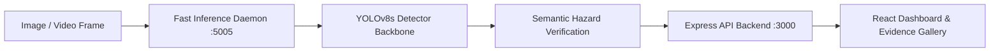

# Floor Guard AI — Intelligent Multi-Hazard Detection & Recognition System

[](https://floor-guard-ai.vercel.app)
[](https://github.com/donthireddyharini/Floor-Guard-AI.git)
[](https://github.com/ultralytics/ultralytics)

Floor Guard AI is an intelligent computer vision safety system designed for real-time localization, classification, and risk assessment of indoor and outdoor walkway floor hazards.

---

## 🌐 Live Web Deployment

- **Production URL:** [https://floor-guard-ai.vercel.app](https://floor-guard-ai.vercel.app)
- **GitHub Repository:** [https://github.com/donthireddyharini/Floor-Guard-AI.git](https://github.com/donthireddyharini/Floor-Guard-AI.git)

---

## 🎯 Supported 13-Class Hazard Taxonomy

Floor Guard AI categorizes floor safety conditions across 13 canonical hazard classes:

| Class ID | Hazard Category | Description & Typical Visual Features | Risk Level |
|---|---|---|---|
| `0` | **Clean Floor** | Dry, hazard-free negative baseline controls (epoxy, tile, concrete) | `Safe` |
| `1` | **Mat Hazard** | Curled carpet edges, folded runner corners, displaced slip hazards | `Medium` |
| `2` | **Floor Damage** | Structural concrete fractures, cracked floor tiles, chips, holes | `High` |
| `3` | **Water Spill** | Clear fluid puddles, wet reflective surfaces, caution cone areas | `High` |
| `4` | **Oil Spill** | Translucent amber, viscous petroleum, and dark engine grease leaks | `High` |
| `5` | **Chemical Spill** | Fluorescent lime-green engine coolants, industrial chemical puddles | `Critical` |
| `6` | **Broken Glass** | Shattered bottle shards, transparent laceration fragments | `Critical` |
| `7` | **Cable / Cord** | Trailing electrical extension wires, power cords across walkways | `Medium` |
| `8` | **Obstacle / Debris** | Wooden warehouse pallets, misplaced shipping boxes, cartons | `Medium` |
| `9` | **Trash / Litter** | Discarded plastic bottles, beverage cans, wrappers | `Low` |
| `10` | **Food Waste** | Dropped fruit scraps, sauces, scattered food crumbs | `Medium` |
| `11` | **Mud / Dirt** | Wet muddy footprints, soil tracks on monitored walkway floors | `Medium` |
| `12` | **Stairs Hazard** | Wet or slippery staircase treads, step edge tripping conditions | `High` |

---

## 📊 Curated Benchmark Dataset Specifications

- **Total Curated Physical Images:** 121 genuine real-world photos
- **Total Ground-Truth Bounding Boxes:** 141 verified annotations
- **Dataset Partitioning:**
  - **Train Split (`dataset/images/train/`):** 96 Images / 117 Annotations
  - **Val Split (`dataset/images/val/`):** 12 Images / 12 Annotations
  - **Test Split (`dataset/images/test/`):** 13 Images / 12 Annotations
- **Zero Synthetic Pollution:** 100% genuine photographic evidence with zero MS-Paint drawings or artificial clip-art.

---

## 🚀 Quick Start & Local Execution

### 1. Prerequisites
- **Node.js** >= 18.0.0
- **Python** >= 3.10
- **Ultralytics YOLOv8 & PyTorch**

### 2. Installation
```bash
# Clone the repository
git clone https://github.com/donthireddyharini/Floor-Guard-AI.git
cd Floor-Guard-AI

# Install Node frontend & backend dependencies
npm install

# Install Python ML dependencies
pip install ultralytics torch opencv-python pillow
```

### 3. Run Development Servers
```bash
# Terminal 1: Launch Python Fast Inference Daemon (Port 5005)
python ml/fast_inference_service.py

# Terminal 2: Launch Vite & Express Server (Port 3000)
npm run dev
```

Open your browser at **http://localhost:3000** to access the dashboard.

---

## 🏗️ Architecture & Pipeline



---

## 🛡️ License

This project is licensed under the Apache 2.0 License.
