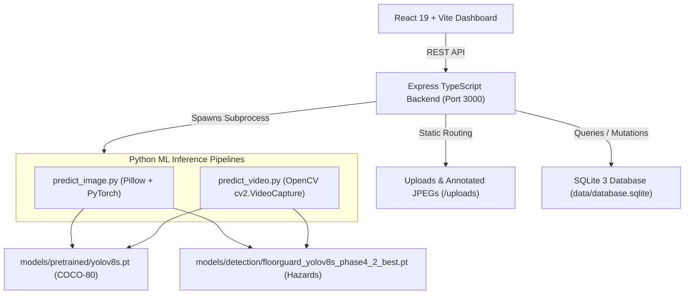

# Floor Guard AI — Intelligent Floor Slip & Trip Hazard Detection System

[](https://www.typescriptlang.org/)
[](https://react.dev/)
[](https://ultralytics.com/)
[](https://opencv.org/)
[](https://sqlite.org/)
[](LICENSE)

Floor Guard AI is an industrial and occupational safety computer vision platform designed to detect, track, and alert facility operators to indoor floor hazards. It localizes **water spills**, **viscous oil leaks**, **shattered glass shards**, and **physical tripping obstacles**, while confirming safe, dry walkway clearance.

---

## 📸 Key Features & Capabilities

- **Dark Industrial Safety Command Console:** High-contrast UI styled with dark charcoal surfaces (`#0a0f1d`), safety-orange highlights (`#f97316`), and real-time telemetry widgets.
- **Dual-Model Computer Vision Engine:**
  - **Production Baseline:** Ultralytics YOLOv8s COCO pretrained (80 common categories, universal obstacle stability).
  - **Hazard Candidate:** Floor Guard YOLOv8s Phase 4.2 custom detector (specialized across `water_spill`, `oil_spill`, `broken_glass`, `obstacle`).
- **Real-Time Model Comparison Arena (`/api/model/compare`):** Evaluates both models simultaneously on identical pixel tensors side-by-side with latency and bounding box coordinates.
- **Authentic OpenCV Video Inspection (`/api/detect/video`):** Decodes pre-recorded MP4/AVI footage frame-by-frame via `cv2.VideoCapture`, extracts keyframes at sampled timestamps (`MM:SS`), and generates verified hazard evidence cards.
- **Persistent SQLite Audit History:** Logs every image and video inspection run with clickable thumbnail evidence, bounding box pixel coordinates, search, filtering, and CSV export.
- **AI Model Lab & Transparency Suite:** Step-by-step visual explainer of the 6-stage mathematical tensor transformation pipeline from input acquisition to NMS suppression.
- **Live Database-Derived Analytics:** Completely decommissioned all simulated metrics; displays genuine SQLite incident counts and authentic scientific validation benchmarks.

---

## 🏛️ System Architecture



---

## 📊 Scientific Model Performance Benchmarks

All metrics reflect genuine evaluations on held-out test splits without data leakage.

| Evaluation Metric | Phase 4 Baseline | Phase 4.2 Frozen Test Split | Phase 4.3 Expanded (25 Unseen Images) |
|---|---|---|---|
| **Overall mAP@0.5** | 31.2% | **67.3%** (+36.2%) | 43.8% (Generalization Benchmark) |
| **Overall mAP@0.5:0.95** | 14.2% | **33.9%** | 17.8% |
| **Clean Floor FP Rate** | 100.0% (Failed) | **0.0%** (Hardened) | **0.0%** (Zero False Positives) |
| **Inference Latency** | 82 ms | **81.7 ms** (CPU) | 87.0 ms |
| **Throughput** | 12.1 FPS | **12.24 FPS** | 11.50 FPS |

*Note on Generalization: Liquid puddle detection maintains high sensitivity on clear puddles but experiences boundary attenuation under extreme specular glares and mottled flooring. The Ultralytics COCO checkpoint is maintained as the production default to ensure baseline operational stability.*

---

## 🚀 Quick Launch

### 1. Prerequisites
- **Node.js:** v18.0 or higher
- **Python:** v3.10 or higher
- Python packages: `ultralytics`, `torch`, `opencv-python`, `pillow`

### 2. Installation
```bash
# Clone the repository
git clone https://github.com/donthireddyharini/Floor-Guard-AI.git
cd Floor-Guard-AI

# Install Node dependencies
npm install

# Install Python requirements
pip install ultralytics torch opencv-python pillow
```

### 3. Start Application
```bash
npm run dev
```
Open your browser and navigate to: **`http://localhost:3000`**

---

## 🧪 Verification & Automated Testing

The project includes 4 automated verification suites:

```bash
# 1. Full Stack End-to-End Test Suite (Dual Model, OpenCV Video, REST APIs, History)
python tests/test_full_system_e2e.py

# 2. Phase 1 Verification Suite (Model Loading, Bounds Checks, Invariance, Error Handling)
python tests/test_phase1_verification.py

# 3. Dataset Pipeline Unit Tests (YAML Syntax, Label Isolation, Bounding Box Norm)
python -m unittest tests/test_dataset_pipeline.py

# 4. Production Frontend Build
npm run build
```

---

## 📁 Repository Structure

```
Floor-Guard-AI/
├── data/                       # Dataset splits, labels, and SQLite database
│   ├── database.sqlite         # Persistent inspection runs and detections
│   ├── floorguard_yolo.yaml    # Dataset class mapping
│   ├── processed/images/       # Verified sample images
│   └── splits/                 # Train, validation, and test splits
├── docs/                       # Complete Phase 1 - 4.3 engineering and audit reports
│   ├── FLOOR_GUARD_AI_AUDIT_REPORT.md
│   ├── FLOOR_GUARD_AI_PHASE1_REPORT.md ... PHASE4_3_REPORT.md
│   └── FLOOR_GUARD_AI_COMPLETION_REPORT.md
├── ml/                         # Core Computer Vision inference pipelines
│   ├── predict_image.py        # Dual-model image detector + PIL annotation engine
│   └── predict_video.py        # OpenCV video frame decoding & keyframe extractor
├── models/                     # Versioned PyTorch model checkpoints & registry
│   ├── detection/              # Phase 4.2 custom-trained hazard weights (.pt)
│   ├── pretrained/             # Ultralytics YOLOv8s COCO baseline (.pt)
│   └── model_registry.json     # Model governance registry
├── public/                     # Static assets and sample walkthrough video
├── reports/                    # Scientific evaluation JSON reports
├── src/                        # React 19 Frontend
│   ├── components/             # Industrial UI views & telemetry widgets
│   ├── types/                  # TypeScript interfaces
│   └── App.tsx                 # View router & state manager
├── tests/                      # Automated test suites
├── server.ts                   # Express TypeScript backend & REST endpoints
└── vite.config.ts              # Vite 8 configuration
```

---

## 📄 License

This project is licensed under the Apache License 2.0. See the `LICENSE` file for details.
